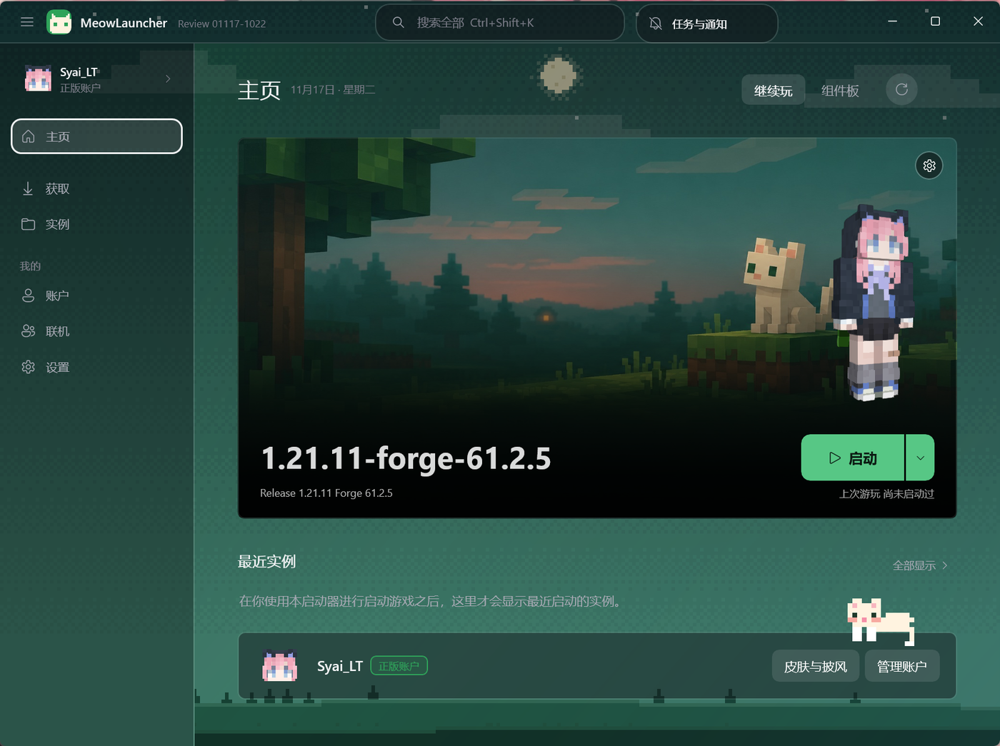
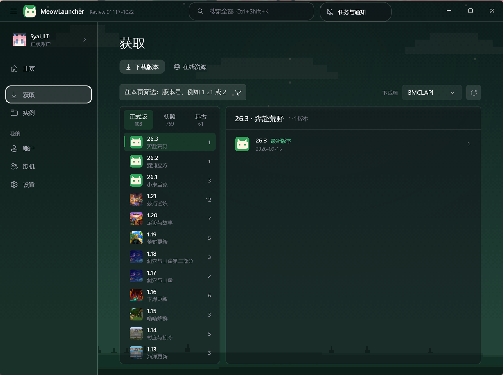

# MeowLauncher

<!-- 待你写：一句话介绍（这是什么、给谁用） -->

> 非官方项目，与 Mojang、Microsoft 无隶属关系。Minecraft 是 Mojang AB 的商标。

## 能做什么

<!-- 待你写：功能列表 -->

## 系统要求

<!-- 待你写 -->

## 开始用

<!-- 待你写 -->

## 常见问题

<!-- 待你写 -->

## 从源码构建

<!-- 待你写 -->

## 致谢

<!-- 待你写：BMCLAPI、MCIM、Modrinth、CurseForge、Azul Zulu、EasyTier 这些实际用到的服务需要标来源 -->

## 许可证

[GPL-3.0](LICENSE)。第三方组件的许可证与声明见发布包里的 `Licenses\`（源码在 `MeowLauncher.WinUI/Licenses/`）。
联机模块 [meow-room-module](https://github.com/ETC233233/meow-room-module) 单独以 MIT 发布。
